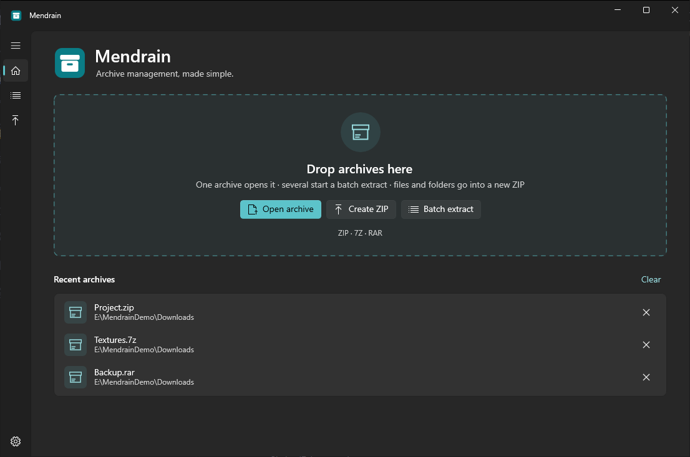
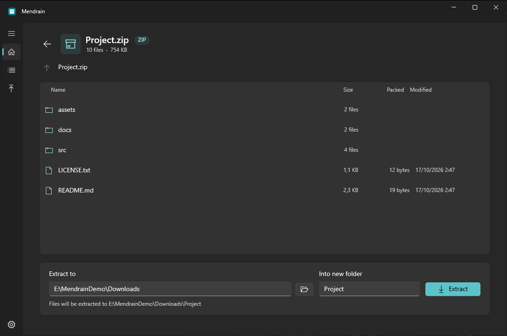
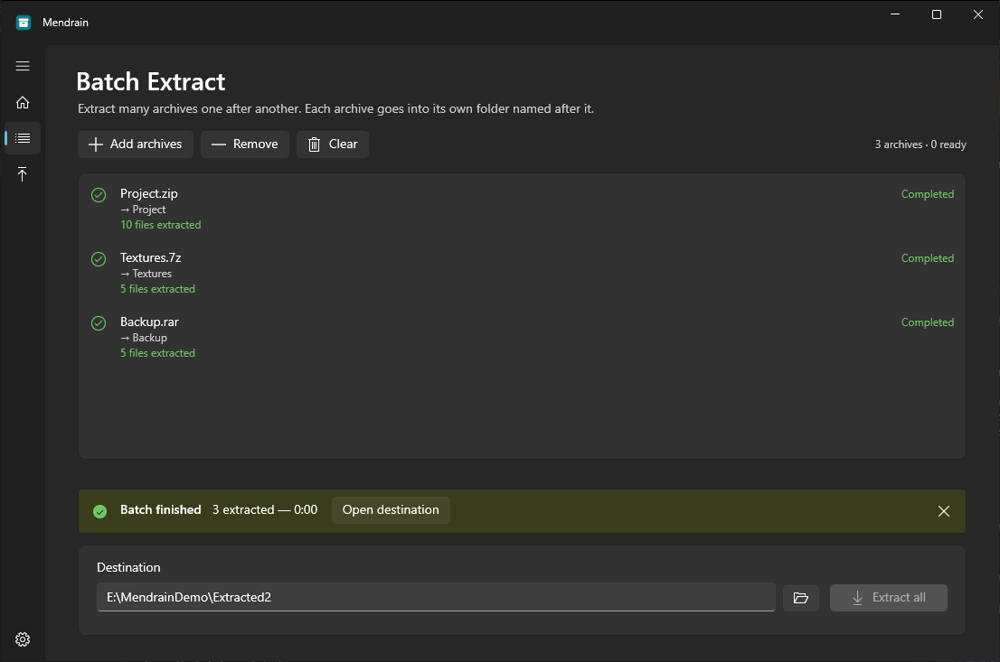
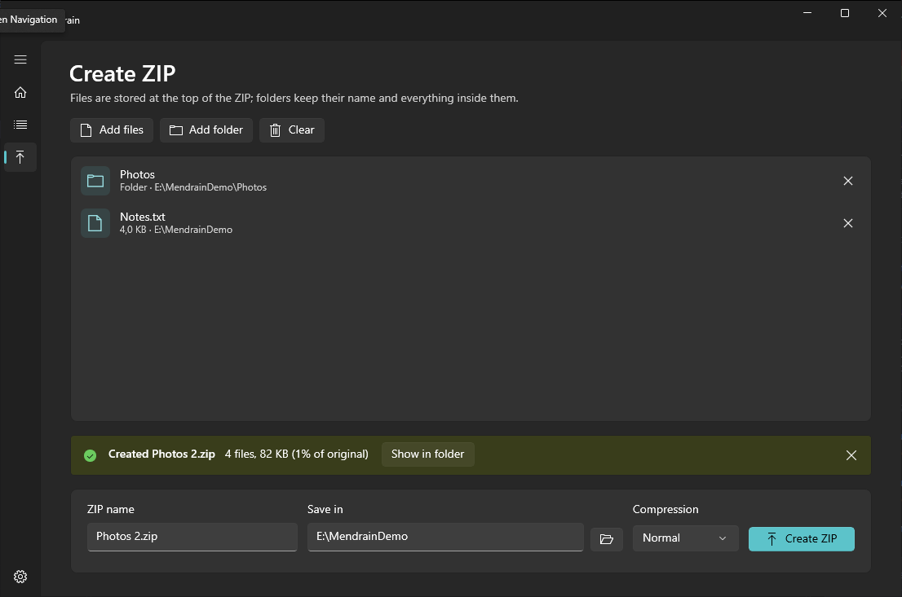
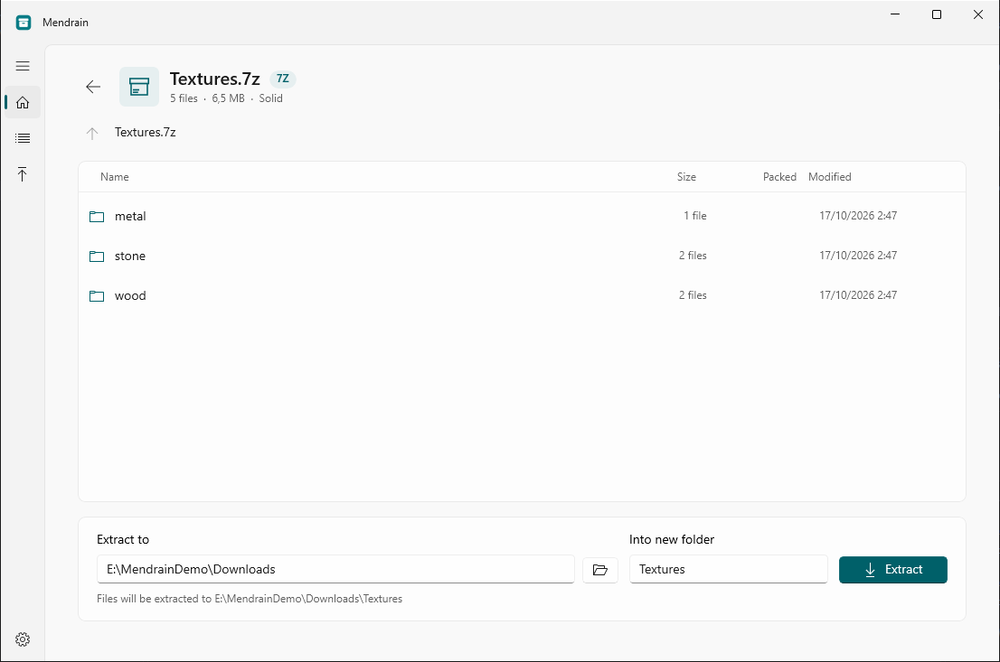

<p align="center">
  
</p>

<h1 align="center">Mendrain</h1>

<p align="center"><strong>A modern archive utility for Windows</strong></p>

<p align="center">
  A cleaner way to create, extract, and manage archives on Windows.
</p>

<p align="center">
  <a href="https://github.com/esteriavaelis/mendrain/releases/latest">Download</a> ·
  <a href="#features">Features</a> ·
  <a href="#supported-formats-and-limitations">Formats</a> ·
  <a href="#building-from-source">Build from source</a> ·
  <a href="https://github.com/esteriavaelis/mendrain/issues">Report an issue</a>
</p>

<p align="center">
  
</p>

## Features

- **Open archives** — browse the folders inside ZIP, 7Z and RAR files, with sizes and dates.
- **Extract** — into a new folder named after the archive (default) or any folder you pick, with progress and Cancel.
- **Batch Extract** — drop many archives and extract them one after another, each into its own folder.
  Folder-name clashes are detected before anything is written, and one broken archive doesn't stop the rest.
- **Create ZIP** — from any mix of files and folders, with four compression levels.
- **Passwords** — asks when an archive is encrypted and tells you clearly when a password is wrong.
  Optionally saves passwords (encrypted for your Windows account) and offers them in a dropdown next time.
- **Safe by design** — files can't be written outside the folder you chose, links are never extracted,
  and existing files are never replaced without your confirmation.
- **File Explorer menu** — right-click ZIP, 7Z and RAR files for *Mendrain → Open with Mendrain / Extract Here /
  Extract to Folder / Batch Extract*, without changing your default archive app.
- **Default archive app (optional)** — Mendrain is listed in *Open with* and Windows' Default apps for ZIP, RAR
  and 7Z, so you can choose it as the default. It never makes itself the default.
- Drag and drop, recent archives, and light, dark or system theme.

## Screenshots

| Archive viewer | Batch Extract |
|---|---|
|  |  |
| **Create ZIP** | **Light theme** |
|  |  |

## Download and installation

Get the latest version from the
[Releases page](https://github.com/esteriavaelis/mendrain/releases/latest). Two downloads are offered:

| File | What it is |
|---|---|
| `Mendrain-Setup-x64.exe` | **Installer** (recommended). One click, no questions: installs for your user account only, without administrator rights, into `%LOCALAPPDATA%\MendrainApp`, adds a Start menu shortcut and the File Explorer menu, lists Mendrain in *Open with* and Default apps for ZIP, RAR and 7Z (your default app is not changed), and can be removed from *Settings → Apps*. Updates itself. |
| `Mendrain-Portable-x64.zip` | **Portable version.** Unzip anywhere and run `Mendrain.exe`. Nothing is installed. Also updates itself (in its own folder). |

Neither download needs .NET or any other runtime installed: everything Mendrain needs is included.

**Notes**
- The downloads are **not code-signed**, so Windows SmartScreen may show "Windows protected your PC".
  Choose *More info → Run anyway* if you trust the source. `SHA256SUMS.txt` on each release lets you verify the files.
- The portable version still stores its preferences, recent-archives list and saved passwords in
  `%LOCALAPPDATA%\Mendrain`, not next to the program.
- **Updates:** a few seconds after it starts, Mendrain checks this repository's GitHub Releases (once per session)
  for a newer stable version. If there is one, a small bar offers **Update** or **Later**; nothing is downloaded
  or installed unless you click Update, and the new version is applied only when you click **Restart now**.
  *Settings → Updates* has *Check for updates* and an opt-in for preview versions. Settings, saved passwords and
  logs live outside the program folder and are kept. Packages are verified against the checksums in the
  release's update feed before they are installed.
- **Upgrading from 0.1.0:** version 0.1.0 used a different installer and can't update itself. Download and run
  the new `Mendrain-Setup-x64.exe` once. Mendrain then offers to remove the old copy (*Remove old version*);
  your settings are kept. Copies of 0.1.0's portable ZIP must be replaced by hand.
- Saved passwords are kept in `%LOCALAPPDATA%\Mendrain\passwords.json`, each encrypted with Windows DPAPI
  for your Windows user account; only archive names and dates are stored in readable form. They can't be
  read by other Windows accounts or on another PC, and are never sent anywhere.

## System requirements

- Windows 10 or later
- 64-bit (x64) PC
- About 175 MB of disk space

Mendrain has been tested on Windows 10 22H2 (x64). Windows 11 should work but hasn't been tested yet.

## Usage

- **Open an archive:** click *Open archive*, drop one archive on the home screen, or open it with
  `Mendrain.exe <archive>`. Double-click folders to browse them, press Backspace to go up.
  Choose *Extract to* and a folder name, then click **Extract**.
- **Extract many archives:** drop several archives on the home screen (or open *Batch Extract* and click
  *Add archives*), choose a destination, then click **Extract all**. Each archive goes into
  `<destination>\<archive name>`. If a folder name is already taken, Mendrain asks whether to use a new name
  (for example `Project (2)`) or skip that archive.
- **Passwords:** when an archive is encrypted, Mendrain asks for its password. The arrow at the right of the
  password field lists saved passwords by archive name (never the password itself); pick one to fill the field,
  or remove it with its delete button (or the Delete key). Tick **Save password** to keep a password: it is
  saved only after it has worked. In Batch Extract, a password saved for an archive with the same file name is
  tried automatically before asking; a password that already failed for an archive is not tried again.
  *Settings → Saved passwords → Remove all* forgets every saved password.
- **From File Explorer:** right-click one or more ZIP, 7Z or RAR files and open the **Mendrain** submenu
  (on Windows 11, choose *Show more options* first):
  - *Open with Mendrain* — opens the archive (several archives go to Batch Extract, ready to start).
  - *Extract Here* — extracts into the folder that contains the archive, exactly like clicking **Extract** with
    an empty folder name: if files already exist, Mendrain asks whether to keep both, skip or replace.
  - *Extract to Folder* — extracts into a folder named after the archive (`Photos.zip` → `Photos\`), next to it.
  - *Batch Extract* — extracts every selected archive, one at a time, each into its own folder next to the
    archives, with the usual conflict check, password prompts and summary. With only one archive selected it
    behaves the same (that archive goes into its own new folder).

  With several archives selected, *Extract Here* and *Extract to Folder* handle them one after another.
  Selected files that aren't ZIP, 7Z or RAR archives are ignored, and Mendrain says so. If Mendrain is already
  open, the request goes to that window and starts after any extraction that is still running.
  The installer adds the menu, and updates keep it pointing at the installed program. For the portable
  version, or to repair the entries, use *Settings → File Explorer menu*. Removing it there (an update won't
  add it back), or uninstalling, deletes only Mendrain's own entries.
- **Make Mendrain the default archive app:** the installer adds Mendrain to *Open with* and Windows' Default
  apps for ZIP, RAR and 7Z, but keeps your current default (for example WinRAR). Windows lets only you change
  the default, one file type at a time. *Settings → Default archive app → Set Mendrain as Default Archive App*
  opens Windows' Default apps with instructions:
  - Windows 10: click *Choose default apps by file type*, then click the app next to `.zip` and choose Mendrain;
    do the same for `.rar` and `.7z`.
  - Windows 11: Settings opens Mendrain's own Default apps page; click `.zip`, `.rar` and `.7z` in turn and
    choose Mendrain.
  - Or right-click an archive, *Open with → Choose another app*, pick Mendrain and tick *Always use this app*.

  After that, double-clicking an archive opens it in Mendrain's viewer (in the open Mendrain window if there is
  one; several archives opened together go to Batch Extract). Windows may also ask once which app to use the
  next time you open such a file, because a new app can open it; that choice is yours. The portable version, or
  an installation updated from 0.2.0, registers itself when you click the button. *Remove* (next to it), or
  uninstalling, deletes only Mendrain's own entries and never changes other apps' registrations.
- **Create a ZIP:** drop files and folders on the home screen (or open *Create ZIP*), pick a name and
  location, then click **Create ZIP**. Selected files go at the top of the ZIP; selected folders keep their
  name and everything inside them.

## Supported formats and limitations

| Format | Extract | Create |
|---|---|---|
| ZIP (incl. ZipCrypto and AES encryption, ZIP64) | Yes | Yes |
| 7Z (incl. solid and AES-encrypted, also with encrypted file names) | Yes | No |
| RAR 5 (incl. solid, encrypted, multi-volume `name.part1.rar` sets) | Yes | No |
| RAR 4 | Expected to work, not tested | No |

Limitations:
- The whole archive is extracted; extracting only selected files isn't supported yet.
- Only RAR `name.partN.rar` multi-volume sets are supported. Old-style `.r00` volumes, split 7Z (`.7z.001`)
  and split ZIP archives are not.
- No RAR/7Z creation, no password-protected ZIP creation, no self-extracting archives, no archive repair.
- File contents, folders and modification dates are restored. NTFS permissions and alternate data streams are not.
- For 7Z archives, a wrong password can't be told apart from damaged data; Mendrain says so in the message.
- The File Explorer menu uses classic menu entries. On Windows 11 they appear under *Show more options*, not in
  the compact menu (that would need a packaged, code-signed app). The menu reads "Extract to Folder" instead of
  showing each archive's name, which would need a native shell extension.
- The Explorer menu was tested on Windows 10 22H2. Windows 11 hasn't been tested.
- The default-app registration was tested on Windows 10 22H2 (Open with list, *Set defaults by app*, opening
  archives through Mendrain's registration). Windows 11's Default apps page link hasn't been tested.
- Neither the installer nor the program is code-signed yet, so Windows SmartScreen may warn on first run.

## How extraction stays safe

- Entry names inside archives are treated as untrusted. Names containing `..`, absolute paths, drive letters
  or network paths are blocked, and every final path is checked to be inside the destination folder.
- Names Windows can't use are adjusted (invalid characters, trailing dots, reserved names such as `CON`), and
  names that differ only by upper/lower case get `name (2)`. Every change is listed in the result.
- Symbolic links, hard links and device files inside archives are never extracted, and Mendrain never writes
  through existing links in the destination.
- Files are first extracted into a hidden temporary folder and checked against the sizes and checksums in
  the archive. They're moved into place only if the whole archive succeeded. On failure or Cancel, only that
  temporary folder is removed — nothing that existed before is deleted.
- Existing files are never replaced unless you choose *Replace* and confirm.

## Building from source

Requirements: Windows 10/11 x64 and the [.NET 10 SDK](https://dotnet.microsoft.com/download).
Visual Studio isn't required.

```powershell
git clone https://github.com/esteriavaelis/mendrain.git
cd mendrain
dotnet run --project src/Mendrain         # start the app (Debug)
```

To build the release packages (installer, portable ZIP and update feed, made with
[Velopack](https://velopack.io); the `vpk` tool is restored automatically from `dotnet-tools.json`):

```powershell
powershell -ExecutionPolicy Bypass -File tools/package.ps1
```

Output goes to `artifacts/`. See [installer/README.md](installer/README.md) for installer, update and release details.
Releases are built by GitHub Actions when a version tag such as `v1.0.0` is pushed; the workflow creates a
draft release for review.

## Reporting issues

Please open an issue on the
[issue tracker](https://github.com/esteriavaelis/mendrain/issues) with your Windows version, the
Mendrain version (*Settings* page), and steps to reproduce. If Mendrain crashed, the file
`%LOCALAPPDATA%\Mendrain\mendrain.log` helps. Please don't attach archives that contain private data.

## License

Mendrain is released under the [MIT License](LICENSE).

Third-party components included in the release packages are listed in
[THIRD-PARTY-NOTICES.md](THIRD-PARTY-NOTICES.md).

---

<p align="center">© 2026 Esteria Vaelis</p>
